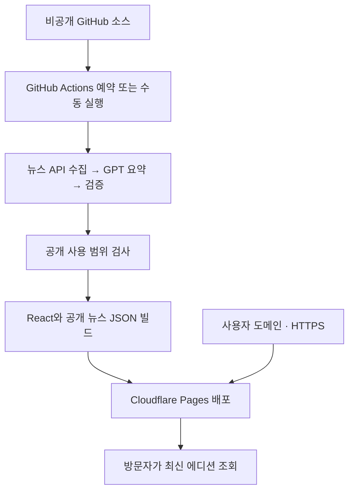

# 오늘의 잇슈 — 공개 도메인 배포 후보와 장단점

작성·공식 문서 확인일: 2026-10-14 KST

**현재 프로젝트에는 Cloudflare Pages + GitHub Actions + 사용자 도메인을 우선 추천합니다.** React 화면과 생성된 뉴스 JSON을 정적으로 제공하고, Python 수집·GPT 처리는 하루 한 번 실행하는 구조를 그대로 활용할 수 있기 때문입니다. 이 추천은 현재 코드 구조와 아래 공식 요금·제약을 비교한 판단입니다.

개인 시연을 빠르게 시작하려면 Vercel도 좋은 후보입니다. GitHub Pages는 기존 배포 설정을 가장 많이 재사용할 수 있지만, 현재 저장소가 비공개라는 점 때문에 GitHub 요금제를 먼저 확인해야 합니다.

이 문서는 후보 비교입니다. 도메인 구매, 서비스 가입·결제, DNS 변경, 실제 사이트 배포는 실행하지 않았습니다.

## 1. 사람들이 주소로 접속하려면 필요한 것

| 요소 | 역할 | 오늘의 잇슈에 적용 |
|---|---|---|
| 호스팅 | 웹페이지와 파일을 인터넷에 제공 | React 빌드 결과 `dist/`와 공개 가능한 뉴스 JSON |
| 접속 주소 | 사람들이 입력하고 공유하는 URL | 서비스 기본 주소 또는 별도로 구매한 도메인 |
| DNS·HTTPS | 도메인을 호스팅에 연결하고 암호화 접속 제공 | 호스팅 대시보드 안내에 따라 연결 |
| 자동 갱신 | 새 뉴스를 수집·요약·검증하여 반영 | GitHub Actions 또는 별도 서버의 예약 작업 |

도메인은 주소이고 호스팅은 실제 결과물을 제공하는 공간입니다. GitHub에 소스를 올린 것만으로 현재 Live 화면이 인터넷에 공개되지는 않습니다. 호스팅과 뉴스 갱신 경로를 연결해야 합니다.

처음에는 제공되는 기본 주소로 공개 확인을 하고, 이후 사용자 도메인을 연결해도 됩니다. GitHub 소스 저장소를 비공개로 유지하면서 방문자에게 웹페이지를 공개하는 구성이 가능합니다. 단, 공개 웹사이트로 전달되는 HTML·JS·뉴스 JSON 자체는 방문자가 읽을 수 있습니다.

## 2. 후보 비교

비용은 호스팅의 시작 가격 또는 공식 무료 범위입니다. 도메인 구매·갱신, 뉴스 API·OpenAI, 세금, 사용량 초과 비용은 별도입니다. 가입 시점과 실제 계정의 요금제를 다시 확인합니다.

| 후보 | 기본 비용·조건 | 장점 | 단점 | 현재 프로젝트 적합도 |
|---|---|---|---|---|
| **Cloudflare Pages + Actions** | 정적 호스팅 무료 범위, Git 연동 Free 빌드 월 500회 | CDN으로 정적 화면 제공, 비공개 GitHub 소스 활용, 사용자 도메인 연결, Python 흐름을 Actions에 유지 | Cloudflare 계정·배포 자격 증명·DNS 설정 필요, 기존 Pages 배포 작업을 교체해야 함 | **가장 추천** |
| **Vercel + Actions** | Hobby 무료는 개인·비상업용, Pro 기본 $20/월 및 사용량·좌석 조건 | Vite 배포와 미리보기, 도메인·HTTPS 설정이 편함, 향후 서버 기능 확장 가능 | 사업용은 무료 플랜 조건 확인 필요, 긴 Python 작업은 별도 실행 권장, 생성 JSON 배포 연결 필요 | 개인 시연에 좋음 |
| **GitHub Pages + Actions** | Free는 공개 저장소, 비공개 저장소는 Pro/Team 등 필요 | 현재 workflow를 가장 많이 재사용, GitHub 한 곳에서 검증·수집·배포 관리 | 현재 private 저장소는 요금제 확인 필요, 정적 전용, 온라인 사업·거래·상업 SaaS 용도의 사용 제한 | 기존 설정 우선이면 후보 |
| **Netlify + Actions** | 신규 credit 플랜 Free 300 credits/월, Personal $9/월 | 미리보기·도메인·HTTPS, 배포 관리와 롤백이 편함 | production 배포당 15 credits로 매일 재배포 시 무료 한도 부족, 방문 트래픽도 credits 사용 | 무료 일일 갱신에는 비추천 |
| **VPS 직접 운영** | 예: DigitalOcean Basic 1GiB $6/월, 2GiB $12/월 | Python·예약·캐시·DB를 한 서버에서 관리, 장기 작업과 기능 확장에 자유로움 | 서버 업데이트·보안·HTTPS·백업·장애 대응을 직접 관리, 정적 사이트만 제공하기에는 운영 부담 | DB·회원 기능이 커질 때 검토 |

공식 근거: [Cloudflare Pages 제한](https://developers.cloudflare.com/pages/platform/limits/), [Vercel 요금](https://vercel.com/pricing), [Vercel Hobby 조건](https://vercel.com/docs/plans/hobby), [GitHub Pages 지원 요금제](https://docs.github.com/en/pages/getting-started-with-github-pages/what-is-github-pages), [GitHub Pages 사용 제한](https://docs.github.com/en/pages/getting-started-with-github-pages/github-pages-limits), [Netlify 요금](https://www.netlify.com/pricing/), [DigitalOcean 가격](https://www.digitalocean.com/pricing/droplets).

## 3. 후보별 적용 방법과 주의할 차이

### A. Cloudflare Pages — 우선 추천

**적용:** GitHub Actions에서 Python 수집·검증 → 공개 검사 → React 빌드 → 완성된 파일을 Pages에 배포합니다. 기본 주소는 `<프로젝트>.pages.dev` 형태이고 사용자 도메인을 추가할 수 있습니다.

장점은 현재의 정적 React·JSON 구조를 유지하고 상시 서버 관리 없이 제공할 수 있다는 점입니다. Cloudflare는 정적 Pages의 요청·대역폭을 무료 제공 범위로 안내합니다. Functions는 별도 Workers 사용량이 적용되므로 정적 호스팅 무료 범위와 구분해야 합니다. [Pages 안내](https://www.cloudflare.com/products/pages/), [제한](https://developers.cloudflare.com/pages/platform/limits/)

현재 workflow의 GitHub Pages upload/deploy 단계를 Cloudflare 배포로 바꾸어야 합니다. 이미 구현한 Python 실행·사용량 제한·검증·이전 에디션 보존 흐름은 재사용합니다. Actions의 포함 실행 시간과 artifact 저장 한도는 별도입니다.

새 Live 프로젝트에는 Actions에서 완성된 결과물을 올리는 Direct Upload 방식을 고려합니다. Git 연동은 소스 push만으로 화면을 배포하기 편하지만, 현재 뉴스 JSON은 Git에서 제외되므로 소스 연결만으로 새 뉴스가 반영되지는 않습니다. Git 연동과 Direct Upload의 프로젝트 설정 차이를 정한 뒤 생성합니다. [CI Direct Upload](https://developers.cloudflare.com/pages/how-to/use-direct-upload-with-continuous-integration/), [Git 연동 차이](https://developers.cloudflare.com/pages/configuration/git-integration/)

사용자 도메인의 apex, 예를 들어 `example.com`을 연결하려면 Cloudflare zone·nameserver 설정이 필요합니다. `news.example.com` 같은 서브도메인은 외부 DNS의 CNAME으로 연결할 수 있습니다. [도메인 연결](https://developers.cloudflare.com/pages/configuration/custom-domains/)

### B. Vercel — 간단한 개인 시연과 미리보기

**적용:** 개인 GitHub 저장소에서 Vite 프로젝트를 가져와 DEMO를 배포하거나, Actions가 생성한 공개 뉴스 결과까지 포함하여 CLI 배포를 연결합니다. 기본 주소는 `<프로젝트>.vercel.app` 형태입니다. [도메인 안내](https://vercel.com/docs/domains/working-with-domains)

장점은 프론트 배포와 변경 버전 확인이 쉽고, 나중에 웹 API·서버 렌더링을 붙일 선택지가 있다는 점입니다. 현재 화면을 Next.js로 바꿔야만 배포할 수 있는 것은 아닙니다.

Hobby는 개인·비상업용으로 제한됩니다. 광고나 사업 목적의 서비스라면 사용 조건과 Pro를 검토합니다. Pro 공식 기본 가격은 $20/월이며 좌석·사용량에 따른 비용은 별도 확인합니다. [Hobby 조건](https://vercel.com/docs/plans/hobby), [가격](https://vercel.com/pricing)

Python 수집·GPT 18회 처리까지 웹 요청 하나에 넣으면 함수 실행 시간·재시도·파일 보관을 새로 설계해야 합니다. 현재는 Actions에서 처리하고 결과를 배포하는 방식이 변경량을 줄입니다. Vercel Cron도 함수 호출 방식이고 Hobby는 일일 실행·시각 정밀도 제한이 있으므로 정확한 오전 7시 발행을 보장한다고 가정하지 않습니다. [Cron 제한](https://vercel.com/docs/cron-jobs/usage-and-pricing), [CLI 배포](https://vercel.com/docs/cli/deploy)

### C. GitHub Pages — 기존 구성의 재사용

**적용:** 현재 workflow를 활용하고 Pages Source·Secrets·모델·공개 데이터 설정을 준비한 뒤 `ENABLE_PAGES=true`로 발행을 활성화합니다. 기본 경로는 `https://dlwo8520.github.io/today-issue/` 형태이며 사용자 도메인도 연결할 수 있습니다. 위 주소는 예상 형식이며 현재 배포 완료 주소가 아닙니다. [기능](https://docs.github.com/en/pages/getting-started-with-github-pages/what-is-github-pages), [사용자 도메인](https://docs.github.com/en/pages/configuring-a-custom-domain-for-your-github-pages-site/about-custom-domains-and-github-pages)

장점은 구현된 Actions·artifact 복원·정적 상세 URL을 가장 많이 재사용할 수 있다는 점입니다. 단점은 현재 저장소가 private라 GitHub Free만으로 Pages를 제공할 수 없다는 점입니다. Pro 등 지원 플랜을 확인하거나, 소스 공개를 선택하는 별도 판단이 필요합니다. 현재 계정 요금제는 확인하지 않았으며 저장소 공개로 임의 변경하지 않습니다.

또한 온라인 사업·상업 거래·상업 SaaS를 주목적으로 하는 무료 호스팅 용도에는 GitHub 사용 제한이 있습니다. 단순히 “모든 상업적 콘텐츠가 금지”라고 확대 해석하지 않되 서비스의 사업화 단계에서는 확인해야 합니다. [공식 제한](https://docs.github.com/en/pages/getting-started-with-github-pages/github-pages-limits)

### D. Netlify — 일일 재배포 비용을 먼저 계산

**적용:** Actions에서 생성한 정적 결과를 production으로 배포합니다. 기본 `<프로젝트>.netlify.app` 주소와 사용자 도메인·관리형 HTTPS를 사용할 수 있습니다. [도메인](https://docs.netlify.com/manage/domains/domains-fundamentals/understand-domains/), [HTTPS](https://docs.netlify.com/manage/domains/secure-domains-with-https/https-ssl/)

미리보기와 정적 배포 관리가 편하지만, 신규 credit 플랜은 Free 월 300 credits, 성공한 production 배포당 15 credits입니다. **하루 한 번 30일간 재배포하면 배포만으로 450 credits**이며 요청·대역폭 사용량은 추가입니다. 현재처럼 뉴스 JSON을 화면과 함께 매일 배포하면 무료 플랜 안에 맞지 않습니다. [요금](https://www.netlify.com/pricing/), [credit 계산](https://docs.netlify.com/manage/accounts-and-billing/billing/billing-for-credit-based-plans/how-credits-work/)

Personal은 $9/월·1,000 credits로 안내됩니다. 뉴스 JSON만 별도 저장소에서 갱신하는 방식으로 배포 횟수를 줄일 수 있지만 추가 저장소·캐시·복원 설계가 필요합니다. 기존 legacy 계정에는 다른 가격이 적용될 수 있으므로 계정별 확인이 필요합니다.

### E. VPS — 직접 서버 운영

**적용:** Linux 서버에서 Python을 예약 실행하고, 생성 JSON과 정적 화면을 Nginx 또는 Caddy 같은 웹서버로 제공합니다. 사용자 도메인의 DNS를 서버로 연결하고 HTTPS를 구성합니다.

장점은 긴 실행, 누적 수집 이력, 파일 캐시, DB, 회원 기능을 한 환경에서 다룰 수 있다는 점입니다. 단점은 서버 관리·백업·모니터링·장애 대응 책임이 커진다는 점입니다.

가격 예시는 DigitalOcean Basic 1GiB $6/월, 2GiB $12/월입니다. 실제 빌드·파이프라인 메모리 요구량을 측정한 뒤 사양을 선택해야 하며, 백업·추가 저장소·전송 초과는 별도입니다. 지금의 정적 MVP에는 우선순위를 낮게 둡니다. [가격](https://www.digitalocean.com/pricing/droplets)

## 4. 현재 추천 운영 구조

방문자마다 GPT를 호출하는 구조가 아니므로, 방문 증가가 곧 GPT 호출 증가를 의미하지 않습니다. 뉴스·GPT 비용은 기본적으로 갱신 빈도와 실제 생성량에 좌우되고, 호스팅 트래픽은 별도로 계산합니다.

GitHub Free의 비공개 저장소 Actions에는 월 2,000분과 500MB artifact 저장이 포함됩니다. 계정의 다른 프로젝트와 함께 쓰는 한도이므로 실제 실행 시간을 관측합니다. 예를 들어 실행당 10분·월 30회라면 300분이라는 계산이지만, 이는 측정된 이 프로젝트의 실행 시간이 아닙니다. [Actions 요금](https://docs.github.com/en/billing/concepts/product-billing/github-actions)

현재 예약 `0 22 * * *`는 KST 오전 7시입니다. Actions 예약은 지연되거나 실행이 누락될 수 있어 정확한 시각 보장이 아닙니다. 지연 상태를 화면에 표시하고 실제 운영 로그를 확인합니다. [schedule 제약](https://docs.github.com/en/actions/reference/workflows-and-actions/events-that-trigger-workflows#schedule)

## 5. 준비·변경할 항목

1. **공개할 데이터 결정:** 화면 확인용 DEMO는 별도로 공개할 수 있습니다. 실제 뉴스는 현재 `local_private`, `public_reuse_granted=false`이므로 API 계정의 공개 요약·AI 전송·보관·메타데이터·사진 이용 범위를 확인한 뒤 공개 설정을 적용합니다.
2. **호스팅 선택:** 우선 Cloudflare Pages, 개인 시연 우선이면 Vercel, 기존 GitHub 설정 우선이면 계정 플랜 확인 후 Pages를 선택합니다.
3. **배포 계정·자격 증명 준비:** API 키와 배포 토큰은 Actions Secrets에 두고 프론트의 `VITE_` 변수로 전달하지 않습니다. 도구별 실제 발급·계정 연결은 선택한 뒤 진행합니다.
4. **workflow 연결:** Python 처리·검증·이전 정상 데이터 복구를 유지하며 대상 호스팅에 맞게 마지막 배포 작업을 구성합니다. 현재 `ENABLE_PAGES`는 기존 GitHub Pages용이므로 다른 호스팅에 그대로 켜는 방식으로 처리하지 않습니다.
5. **기본 주소 확인:** 공개 가능한 파일만 담은 빌드로 홈·사진·원문 링크·상세 직접 URL·모바일을 확인합니다. 실제 `.env`·원문·캐시·private 캡처·현재 private Live `dist`는 올리지 않습니다.
6. **도메인 연결:** 보유 도메인이 있으면 연결하고, 없으면 원하는 이름의 등록 가능 여부·첫해 가격·갱신 가격을 확인한 뒤 구매합니다. HTTPS와 대표 주소 리다이렉트를 확인합니다.
7. **예약·장애 검사:** 새 뉴스 갱신, 실패 시 이전 에디션 유지, 실제 비용·한도·수집 기준 시각을 확인합니다. 기간 내 수집 이력이 필요한 경우 비공개 상태 저장 방식을 별도로 설계합니다. 현재 원격 복원 구성은 정상 에디션 중심입니다.

## 6. 선택 기준

| 우선 목표 | 추천 후보 |
|---|---|
| 비공개 소스 유지·저비용·매일 뉴스 갱신 | **Cloudflare Pages + Actions** |
| 개인 비상업 시연·빠른 프론트 배포 | Vercel Hobby + 필요 시 Actions |
| 기존 배포 코드 재사용 | 지원 GitHub 플랜 확인 후 GitHub Pages |
| Netlify 운영 경험 활용 | 일일 배포 credits를 반영한 유료 플랜 또는 데이터 분리 |
| 회원·DB·관리 기능과 장기 Python 작업 확대 | VPS 또는 이후 관리형 백엔드 검토 |

현재 상세 주소는 hash 기반이라 공유·새로고침은 가능하지만, 개별 기사 검색 노출·공유 미리보기를 강화하려면 실제 이슈별 정적 페이지 또는 서버 렌더링을 별도로 검토합니다. 호스팅 선택만으로 이 구조가 자동 변경되지는 않습니다.

관련 프로젝트 문서: [전체 1차 개발 정리](PHASE_1_REPORT.md), [기존 배포 안내](DEPLOYMENT.md), [공개 운영 체크리스트](LIVE_LAUNCH_CHECKLIST.md).
