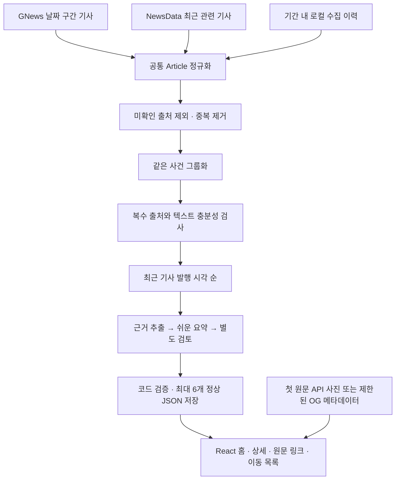

> **개발·조사 이력 — 1차 개발 및 후속 작업**
> 아래 내용은 각 항목의 작성 당시 기록입니다. 현재는 2026-10-15 11:21 KST 고정본을 유지하며 GPT·뉴스 API와 갱신을 중지했습니다. 실행 절차는 [시작하기](GETTING_STARTED.md), 운영 상태는 [고정 운영](FROZEN_EDITION.md)을 따릅니다.

# 오늘의 잇슈 — 1차 개발 전체 정리

작성일: 2026-10-13 · 기준 시간대: Asia/Seoul

> 최신 후속 작업(2026-10-15): 글의 제목·요약 박스·문단·용어·주장 주체 표시를 다듬고 오늘 기준 이슈 6개와 사진 6개를 Cloudflare에 반영했습니다. 프론트 21개·DEMO 브라우저 5개·실제 주소 Live 브라우저 1개와 빌드를 통과했습니다. [가독성 개선과 최신 배포](READABILITY_UPDATE.md).

> 후속 작업: 2026-10-14 Cloudflare에 실제 이슈 6개·첫 원문 사진 6개를 배포했습니다. 새 수집은 451건 → 분석 440건 → 413그룹 → 적격 후보 17개 → 검증 통과 6개입니다. 요청에 따라 메일 인증 없이 지정 이메일 입력으로 입장하며 서버 이메일 비교와 서명 쿠키를 적용했습니다. 이는 본인 인증이 아니므로 같은 이메일을 아는 사람도 입장할 수 있습니다. Python 112개·입장 서버 8개·실제 주소 Live 브라우저 1개가 통과했습니다. 자동 갱신은 GitHub Secrets 미등록으로 대기 상태입니다. [현재 운영](CLOUDFLARE_PRIVATE_SETUP.md), [뉴스 이용 조건](NEWS_USAGE_REVIEW.md). 아래 내용은 2026-10-13 1차 개발 당시의 기록입니다.

**현재까지 React 뉴스 화면, GNews·NewsData·OpenAI 실제 연동, 최근 2주 복수 출처 이슈의 최신순 최대 6개 선정, 원문 사진과 상세 이동 목록을 구현하고 로컬 Live 검증을 완료했습니다.** 이 문서는 최초 기획부터 현재 수정 사항까지의 전체 기록입니다. 1차 GitHub 전달 범위는 소스·설정 예시·DEMO·테스트·문서입니다. 실제 뉴스와 사진이 포함된 비공개 Live 결과의 공개 서비스 전환은 별도 운영 단계입니다.

## 1. 서비스 목적과 범위

오늘의 잇슈(Today’s Issue)는 반복되는 뉴스 보도를 같은 사건으로 묶고, 여러 출처의 근거를 바탕으로 주요 이슈를 쉽게 설명하는 AI 뉴스 큐레이션 웹서비스입니다. “하루를 이해하는 5분”은 제품의 읽기 경험 목표이며, 사용자 실험으로 확인된 수치는 아닙니다.

| 항목 | 현재 구현 |
|---|---|
| 수집 기간 | 실행 기준 시각 직전 14일, 정확히 336시간 |
| 후보 조건 | 같은 사건의 실제 언론사 2곳 이상·추정 독립 원출처 2개 이상·충분한 제공 텍스트 |
| 표시 순서 | 사건에 포함된 가장 최근 기사 발행 시각의 내림차순 |
| 표시 개수 | 검증에 통과한 이슈 최대 6개 |
| 주요 보도 사진 | 상세의 첫 번째 원문에 연결된 사진 |
| 상세 이동 | 공유 가능한 hash URL와 오른쪽 이슈 목록 |
| 사용자 화면 | 반응형 홈·상세, 원문 링크, 쉬운 설명, 주장 주체 표시 |
| 실제 운영 상태 | 로컬 비공개 Live 실행·검증 완료 |
| 공개 서비스 | 미전환; 뉴스·사진 이용 범위와 원격 운영 확인 필요 |

최신순은 수집 시각이나 GPT 생성 시각이 아닌 **기사 발행 시각** 기준입니다. 수집 범위가 2주라는 것은 해당 기간의 모든 기사를 확보한다는 뜻이 아닙니다. 공급자의 제공 범위와 요청 상한 안에서 확보한 자료를 분석합니다. 적격 후보나 검증 통과 결과가 부족하면 실제 결과만 표시하며 가짜 기사로 6개를 채우지 않습니다.

로그인·회원가입·개인화·사용자 댓글·검색·광고·결제·관리자 대시보드·DB·과거 에디션 아카이브는 현재 MVP 범위에 포함하지 않았습니다.

## 2. 기획부터 현재까지의 진행 이력

| 단계 | 요청 및 구현 결과 |
|---|---|
| 최초 MVP | 빈 작업 폴더에 독립 프로젝트 생성. React 홈·상세, 가상 이슈 6개의 DEMO, Python RSS 처리·그룹화·요약 검증, 정적 배포 구성 구현 |
| 실제 운영 준비 정리 | API·소스 권한·키·계정·운영·모니터링 준비 항목을 `LIVE_LAUNCH_CHECKLIST.md`로 작성 |
| 실제 API 연결 | 사용자가 제공한 키를 로컬 환경변수로 설정. GNews·NewsData HTTP 200 및 OpenAI 구조화 응답 확인. 제한된 단계 실행과 비용 기록 추가 |
| 초기 Live | 수집 스냅샷 15건 → 중복 제거 14건 → 11그룹 → 적격 후보 2개 → 최종 검증 통과 1개. API 총 기사 수와 복수 출처 적격 이슈 수가 다른 이유 확인 |
| 최근 7일 전환 | 사용자가 월요일 기준 대신 최근 7일을 선택. 168시간 수집·그룹화, 날짜 구간 조회, 수집 이력, 겹치는 사건 보강. 121건 → 118건 → 107그룹 → 후보 5개 → 검증 통과 4개 |
| 최신 요청 반영 | 최근 2주·최신순 최대 6개, 긴 처리 안내 제거, 중복 날짜 제거, 첫 원문 사진, 문장별 출처 번호·선정 설명 제거, 상세 오른쪽 이동 목록 구현 |
| 현재 로컬 결과 | 이력 포함 291건 → 분석 285건 → 270그룹 → 적격 후보 8개 → 최신순 검증 통과 6개. 실제 원문 사진 6개 로드 확인 |
| 1차 전달 | 전체 개발 기록과 현재 실행·검증·운영 문서 정리. 키와 비공개 자료를 제외한 소스 업로드 패키지 준비 |

위 수치는 서로 다른 실행 단계의 관측 기록입니다. 이전의 1개·4개와 현재의 6개는 같은 수집 결과를 다른 방식으로 표현한 것이 아닙니다. `WEEKLY_UPDATE.md`와 `FINAL_REPORT.md`는 앞선 단계의 이력으로 보존합니다.

## 3. 최종 화면 수정 사항

1. 홈의 기간을 “최근 2주”로 변경했습니다. 복수 출처 조건을 충족하는 사건을 최신 기사 시각 순으로 검증하고 최대 6개를 표시합니다. 조회수·댓글수는 현재 정렬 기준에 사용하지 않습니다.
2. 검증 제외·캐시 사용·무료 플랜 제한·로컬 평가 범위를 길게 설명하던 화면 문구를 제거했습니다. 수집 메타데이터와 내부 검증 근거는 보존하며, 실제 로딩·연결 오류·갱신 실패 안내는 유지합니다.
3. “하루를 이해하는 5분”과 소개 문구 아래의 중복 날짜를 제거하고 옆의 날짜 영역을 유지했습니다.
4. 홈 카드와 상세에 첫 번째 원문의 사진을 표시합니다. “사진 출처 · 언론사”를 표시하고 이미지 로드 실패 시 사진 영역을 숨깁니다.
5. 글마다 붙던 `[1]`, `[2]` 등의 출처 번호와 “이 이슈는 어떻게 선정되었나요” 영역을 제거했습니다. 상세 아래의 원문 링크와 필요한 주장 주체 표시는 유지합니다.
6. PC 상세의 오른쪽에 현재 에디션의 이슈 목록을 배치했습니다. 클릭하면 해당 상세로 이동하고 현재 이슈를 강조합니다. 작은 화면에서는 본문 아래에 목록을 표시합니다.

기존의 녹색 계열 디자인과 읽기 중심 형식을 유지했습니다. PC는 카드 3열, 태블릿 2열, 모바일 1열이며 상세 본문은 약 700px, PC 이동 목록은 약 280px입니다. 공유 URL은 `#/issue/<id>` 형식입니다.

## 4. 기술 구성과 데이터 흐름

| 구분 | 사용 기술 및 역할 |
|---|---|
| 프론트엔드 | React 19, TypeScript, Vite 7, Tailwind CSS 4 |
| 브라우저 데이터 검증 | Zod, 공유 JSON Schema |
| 파이프라인 | Python 3.13, Pydantic, httpx, feedparser, OpenAI SDK |
| 뉴스 API | GNews, NewsData.io |
| GPT | Responses API Structured Outputs, 환경변수로 모델 선택 |
| 그룹화 | 문자 2·3·4-gram TF-IDF, 코사인 유사도, complete-link |
| 테스트 | pytest, Ruff, Vitest, Testing Library, Playwright, axe |
| 저장 | 검증된 JSON, 로컬 입력별 캐시·사용량 기록 |
| 운영 구성 | GitHub Actions, 정적 빌드, 선택적 GitHub Pages |



API 키는 Python 실행에만 사용합니다. 브라우저는 생성된 JSON을 읽으며 뉴스·GPT API를 직접 호출하지 않습니다. 상시 백엔드 서버나 사용자 DB 없이 로컬 또는 예약 파이프라인으로 에디션을 생성하는 구조입니다.

## 5. 뉴스 API 수집 방식과 상한

### GNews

- 한국어·한국 기준 `top-headlines`를 날짜 구간 14개로 나누어 요청합니다.
- 최근 6개 구간은 두 번째 페이지까지 조회하여 회당 최대 20회의 GNews 요청으로 보강합니다.
- 요청당 최대 10개 기사이며 배열의 순서를 조회수나 인기 순위로 취급하지 않습니다.
- 관련 `search` 기능도 구현했지만 현재 설정은 0회입니다. 앞선 실행에서 빈 결과가 관측되어 날짜 구간과 페이지 보강을 우선했습니다.
- 응답 완료 뒤 1.25초 간격을 두며, 429 속도 제한과 403 일일 쿼터 오류를 구분합니다.

### NewsData

- 한국어·한국 기준 `latest`에 관련 키워드를 전달하며 회당 최대 6회 요청합니다.
- 현재 latest 제공 범위는 최근 48시간입니다. NewsData 자체가 2주 전체를 제공한다고 표시하지 않습니다.
- 계정의 archive 사용 권한이 확인되지 않아 유료 과거 조회를 가정하거나 호출하지 않습니다.
- 응답 완료 뒤 0.25초 간격을 둡니다.

### 현재 공통 설정

| 설정 | 값 |
|---|---:|
| 수집·그룹화 시간 범위 | 336시간 |
| 뉴스 API 요청 시도 총상한 | 26회 |
| 공급자별 상한 | GNews 20회 / NewsData 6회 |
| 요청당 최대 기사 | 10개 |
| GPT 요청 시도 상한 | 18회 |
| 최대 성공 이슈 | 6개 |
| 순위 후보 보관 상한 | 12개 |
| 이슈당 최대 입력 기사 | 8개 |
| 독립 원출처 최소 수 | 2개 |
| 출처별 제공 설명 최소 길이 | 50자 |
| 뉴스·수집 스냅샷 캐시 TTL | 6시간 |
| 뉴스 응답 크기 / 타임아웃 | 2MiB / 15초 |

예산은 요청 전에 예약하며 실패도 시도 수에 포함합니다. 기본 API 뉴스 자동 재시도는 0회입니다. GPT도 SDK 자동 재시도 0회와 별도 상한을 적용합니다. 18회는 검증이 모두 성공하는 6개 사건의 3단계 처리에 해당하지만, 실패에 예산을 사용하면 발행 개수가 줄어들 수 있습니다.

API별 실제 가입 플랜은 `unknown`으로 보존합니다. 공식 무료 플랜 안내를 실제 계정 계약이 확인된 것으로 바꾸지 않습니다. 로컬 이력은 기간 안에서만 재사용합니다. 수집 범위를 바꾸거나 스냅샷 TTL이 만료되면 예전 스냅샷을 새로운 2주 수집으로 오인하여 사용하지 않습니다.

기능 범위 참고: [GNews 날짜 필터](https://docs.gnews.io/endpoints/top-headlines-endpoint), [GNews 오류](https://docs.gnews.io/error-handling), [NewsData 문서](https://newsdata.io/documentation). 이 문서는 개발 시 확인한 동작의 기록이며 계정별 계약·쿼터는 운영 전에 다시 확인합니다.

## 6. 중복 제거·사건 겹침·최신순 선정

공통 Article에 제목·제공 설명·content/excerpt·원문 URL·발행일·수집 시각·실제 언론사·공급자 이력·전재 원출처·관측 관심도·사진 URL을 보존합니다. 시각은 명시된 시간대를 사용하고 URL의 추적 파라미터를 정리합니다.

같은 URL을 두 공급자가 반환하면 하나의 기사로 합칩니다. 같은 매체의 같은 제목 재전송도 정리하고 공급자 이력과 사용할 수 있는 사진을 보존합니다. 실제 언론사 별칭과 알려진 연합뉴스·뉴스1·뉴시스 전재를 처리합니다. Daum·Naver 등 포털 이름만 있고 실제 원매체를 확인하지 못한 기사는 독립 출처로 계산하지 않습니다.

문자 TF-IDF와 모든 기사 쌍을 검사하는 complete-link로 사건을 묶습니다. 336시간 안의 후속 보도를 허용하되 명시 날짜, 다른 기관, 인상/인하·승인/거부 같은 반대 행동을 계속 검사합니다. 우크라/우크라이나, 北포로/북 포로/북한군 포로 표기 차이를 정규화하고, 구체적인 사건어와 공통 당사자·문맥 유사도를 함께 검사합니다. 같은 국가나 “휴전” 한 단어만으로 병합하지 않습니다.

후보는 언론사 수·추정 독립 원출처 수·충분한 근거 텍스트를 통과해야 합니다. 이후 가장 최근 기사 발행 시각의 내림차순으로 검증합니다. 표시 출처는 최신 기사 우선으로 배치하고, GPT 입력은 충분한 설명을 우선하는 안정된 순서를 사용하여 근거 품질과 캐시 재사용을 유지합니다.

조회수·댓글수의 결측을 0으로 바꾸지 않으며 공급자의 우선순위·배열 위치·AI 감정 점수로 대신하지 않습니다. 앞선 7일 단계에는 관측 관심도 조건부 정렬을 구현했지만 **현재 사용자 요청에 따라 최신순을 사용합니다.** JSON의 기존 `coverage_recency` 메서드 표기는 호환을 위해 유지되며 현재 실제 선택 전략은 `latest`입니다.

## 7. GPT 요약과 근거 검증

1. 제공된 기사 텍스트에서 사실·주장·상충 보도를 추출합니다.
2. 추출 결과를 바탕으로 쉬운 제목과 설명을 생성합니다.
3. 별도 검토 단계에서 각 문장의 근거·출처·수치·주장 주체·상충 보도 처리를 확인합니다.

모델은 `sourceId/spanId`를 선택하고 코드가 원문 텍스트의 정확한 인용 구간을 연결합니다. Pydantic·Zod·JSON Schema와 코드 검사를 통해 출처 존재, 인용 존재, 필수 검토, 새 수치, 과장된 주장, 누락된 상충 보도 등을 검사합니다. 근거 없는 배경·반응·용어는 추가하지 않으며 핵심 검증에 실패한 후보는 제외합니다.

현재 로컬 모델은 `gpt-5.4-mini`입니다. 초기에는 `gpt-4o-mini`도 실제 평가했습니다. 모델은 `OPENAI_MODEL`로 선택하고 프롬프트·모델·스키마·입력 자료가 일치하는 검증된 결과를 캐시에서 재사용합니다. Responses 요청은 `store=False`이며, 자동 검토의 통과를 독립적인 사실 확인의 보장으로 설명하지 않습니다.

문장별 출처 번호는 사용자 화면에서 제거했지만 내부 근거 연결과 검증은 유지합니다. 상세의 원문 링크를 통해 사용자가 보도를 직접 확인할 수 있습니다.

## 8. 첫 원문 사진 처리

GNews의 `image`와 NewsData의 `image_url`을 보존합니다. 첫 번째 원문에 사진 URL이 없으면 해당 원문 페이지의 제한된 head 메타데이터에서 `og:image` 또는 `twitter:image`를 확인합니다.

이 보완은 최대 512KiB, head 종료 시 중단, 최대 3회 리다이렉트, 공개 HTTP/HTTPS URL과 로컬 주소·인증정보 차단 조건을 적용합니다. 기사 HTML 전문을 저장하거나 요약 근거로 사용하지 않습니다. 메타데이터 결과는 로컬 이미지 캐시에 보관합니다.

브라우저는 원문이 제공한 이미지 URL을 표시합니다. 사진 파일을 저장소에 복사하지 않으며 다른 기사 사진으로 임의 대체하거나 AI 사진을 만들지 않습니다. 링크 접근 가능성과 사진 공개 재사용 권한은 별개이므로 서비스 공개 전 별도 확인이 필요합니다.

## 9. 실패 처리·보안·저장

- `.env`에 실제 키를 두고 Git·ZIP에서 제외합니다. 키에 `VITE_` 접두사를 붙이지 않습니다.
- 뉴스·GPT 요청의 인증·쿼터·속도 제한·타임아웃·응답 형식 오류를 구분합니다.
- 검증 후 임시 파일과 원자적 교체로 정상 JSON을 저장합니다. Windows에서는 필요한 경우 `ReplaceFileW`로 대상 ACL을 유지하며 교체합니다.
- 실행 잠금으로 동시 파이프라인 충돌을 방지하고, 실패 시 이전 정상 에디션을 보존합니다.
- Live 자료가 없거나 실패했을 때 DEMO로 조용히 바꾸지 않습니다. 화면에서 필요한 오류·오래된 데이터 상태를 표시합니다.
- Vite watcher에서 생성 캐시·원자료·진단·비공개 JSON을 제외하여 불필요한 재실행을 줄였습니다.
- `validate_public.py`는 `local_private` 결과를 공개 Live 또는 DEMO artifact에 섞어 올리는 것을 거부합니다.

Edition과 status는 각각 원자적으로 쓰지만 두 파일 전체가 하나의 트랜잭션은 아닙니다. 캐시·진단을 지워도 정상 에디션과 운영 상태를 함께 확인해야 합니다.

## 10. 실제 실행 결과와 비용 기록

최신 로컬 수집 스냅샷 291건에는 이전 기간 내 수집 이력 80건이 포함됩니다. 출처를 확인하지 못한 포털 재게시 5건과 중복 1건을 제외한 285건을 분석했습니다. 270개 사건 그룹 중 복수 출처와 충분성 조건을 통과한 후보는 8개였으며, 최신순 검증 통과 이슈 6개를 저장했습니다.

일부 후보는 검증에서 제외되었습니다. 따라서 291건이나 285건의 기사가 화면의 291개 또는 285개 이슈가 되는 것은 아닙니다. 최종 6개 카드의 첫 원문 사진이 PC·모바일에서 실제 로드되는 것을 확인했습니다. 이후 같은 캐시의 Live 재실행은 뉴스·GPT 신규 호출 각각 0회로 성공했습니다.

개발 전체의 관측된 사용량은 다음과 같습니다. 초기 모델 평가, 실패, 재검증, 기간 변경을 포함한 누적 값이며 정상적인 하루 운영 비용으로 해석하지 않습니다.

| 구분 | 요청 시도 | 입력 토큰 | 출력 토큰 | 추정 USD |
|---|---:|---:|---:|---:|
| GNews | 76 | — | — | 별도 미산정 |
| NewsData | 24 | — | — | 별도 미산정 |
| gpt-4o-mini | 6 | 13,147 | 2,852 | 0.00368325 |
| gpt-5.4-mini | 63 | 170,468 | 37,531 | 0.29311170 |
| GPT 합계 | 69 | 183,615 | 40,383 | **0.29679495** |

마지막 추가 이슈의 3단계 GPT 생성은 신규 3회, 추정 $0.01347525였습니다. 비용은 실제 응답 토큰과 기록된 공개 모델 요율로 계산한 추정이며 청구서가 아닙니다. 뉴스 구독비·세금·환율은 포함하지 않았습니다. 자세한 사용 이력과 원자료는 업로드하지 않는 로컬 `data/reports`에 있습니다.

## 11. 검증 결과

| 검사 | 결과 |
|---|---|
| Python pytest | 92 passed |
| Ruff | All checks passed |
| 프론트 Vitest | 20 passed |
| DEMO Playwright | 5 passed |
| 실제 Live Playwright | 1 passed |
| TypeScript·Vite 프로덕션 빌드 | 성공 |
| 실제 API 연결 | GNews·NewsData HTTP 200, OpenAI 구조화 응답 성공 |
| 사진 | 최종 6개 원문 사진 실제 로드 |
| 레이아웃·이동 | PC·태블릿·모바일, 직접 URL·새로고침·목록 클릭·현재 링크 강조 확인 |
| 접근성 자동 검사 | 검사한 홈·상세의 axe 위반 0 |
| 브라우저 오류 | 검사한 화면의 가로 넘침·pageerror 없음 |
| 비밀값·전달 검사 | 실제 키 미포함과 비공개 자료 제외 확인 |
| 공개 방지 | private Live 결과의 공개 검사 거부 확인 |

고유 테스트는 **92 + 20 + 5 + 1 = 118개**입니다. 반복 실행을 별도 테스트 개수로 세지 않았습니다. 실제 Live 검사는 프로덕션 정적 서버에서도 수행했으며 테스트 코드는 opt-in으로 보관합니다. 로컬 사진 로드 결과는 원문 사이트의 향후 링크 가용성을 보장하지 않습니다.

초기 DEMO 단계에는 `/today-issue/` 하위 경로 브라우저 검사와 production dependency audit 0건도 확인했습니다. 최신 변경에서 해당 audit와 하위 경로 검사를 다시 수행했다는 뜻은 아닙니다. 상세 범위는 [VALIDATION.md](VALIDATION.md)에 있습니다.

## 12. 새 환경에서 실행

Node 22.12 이상 또는 Node 24와 Python 3.13을 준비하고 저장소 루트에서 실행합니다.

```powershell
npm ci
python -m venv .venv
.\.venv\Scripts\python.exe -m pip install -r requirements.lock.txt
# .env가 없는 새 환경에서만 복사하고 값 입력
Copy-Item -LiteralPath .env.example -Destination .env
powershell -NoProfile -ExecutionPolicy Bypass -File .\scripts\dev.ps1 -Mode demo
```

DEMO에는 뉴스·GPT 키가 필요하지 않습니다. `http://127.0.0.1:5173/`에서 가상 이슈 6개를 확인합니다. macOS/Linux는 `.venv/bin/python`을 사용하고 `VITE_DATA_MODE=demo npm run dev`로 실행합니다.

실제 수집에는 `.env`의 `GNEWS_API_KEY`, `NEWSDATA_API_KEY`, `OPENAI_API_KEY`, `OPENAI_MODEL`을 설정합니다. 아래 명령 중 collect/live는 캐시 조건에 따라 실제 호출과 비용이 발생합니다.

```powershell
.\.venv\Scripts\python.exe -m pipeline.run --mode live --dry-run
.\.venv\Scripts\python.exe -m pipeline.run --mode live --stage collect
.\.venv\Scripts\python.exe -m pipeline.run --mode live --stage select --from-cache
.\.venv\Scripts\python.exe -m pipeline.run --mode live --stage summarize --from-cache
.\.venv\Scripts\python.exe -m pipeline.run --mode live --stage live --from-cache
powershell -NoProfile -ExecutionPolicy Bypass -File .\scripts\dev.ps1 -Mode live
.\.venv\Scripts\python.exe scripts/report_usage.py
```

`summarize`는 최상위 후보 1개 미리보기이고 `live`는 최종 에디션 저장입니다. 전체 수집부터 진행하려면 `python -m pipeline.run --mode live`를 사용합니다. `--fresh`는 캐시를 무시하며, `--from-cache`는 수집 스냅샷의 기존 기준 시각을 유지합니다.

## 13. 파일별 역할과 문서

| 경로 | 역할 |
|---|---|
| `src/` | 홈·상세·이슈 목록·사진·상태 화면·hash 라우팅 |
| `src/types/news.ts` | 프론트 JSON 입력 검증 |
| `pipeline/news_apis.py` | GNews·NewsData 수집·응답 정규화·속도 제한 |
| `pipeline/api_pipeline.py` | 단계 실행·수집 이력·선정·Live 생성 |
| `pipeline/normalize.py`, `grouping.py`, `ranking.py` | 중복 정리·사건 묶음·최신순 선정 |
| `pipeline/prompts.py`, `summarize.py` | GPT 3단계와 근거·문장 검증 |
| `pipeline/images.py` | 첫 원문의 제한된 사진 메타데이터 확인 |
| `pipeline/models.py`, `storage.py`, `usage.py` | 스키마·원자적 저장·잠금·캐시·예산·기록 |
| `config/news_apis.json`, `pipeline.json` | 현재 API 상한·선정·시간 범위 |
| `config/sources.json`, `pipeline/sources.py` | 권한 제한이 있는 기존 RSS 경로 |
| `scripts/` | 실행 보조·공개 검사·상태 복원·비용 집계·패키징 |
| `tests/` | Python·프론트·브라우저 회귀 검사 |
| `.github/workflows/daily.yml` | CI와 명시적으로 활성화하는 Pages·예약 운영 |
| `public/data/demo.json` | 키 없이 실행할 수 있는 가상 뉴스 |
| `docs/` | 기획·설계·출처·API·검증·수정 이력·운영 문서 |

현재 실행 기준은 [README](../README.md), [API 연동 안내](API_LIVE_INTEGRATION.md), [검증](VALIDATION.md), [배포](DEPLOYMENT.md)입니다. 이번 화면 요청의 세부 기록은 [UI_REVISION.md](UI_REVISION.md), 이전 7일 변경은 [WEEKLY_UPDATE.md](WEEKLY_UPDATE.md), 최초 DEMO 단계는 [FINAL_REPORT.md](FINAL_REPORT.md)에 보존했습니다.

## 14. GitHub 1차 전달 범위

1차 소스 전달일: 2026-10-14 KST. 저장소: [dlwo8520/today-issue](https://github.com/dlwo8520/today-issue), 비공개(Private), 기본 브랜치 main. 이전의 기능·테스트·수집 수치는 2026-10-13의 검증 기록이며 이번 업로드 과정에서 뉴스 API를 새로 호출하지 않았습니다.

업로드 대상은 실행 가능한 소스, dependency lock, 비밀값 없는 설정, `.env.example`, 가상 DEMO, 공유 스키마, 테스트, 개발 문서, 초기 DEMO 화면 캡처입니다.

제외 대상은 실제 `.env`·키, 원문 수집·캐시·진단·사용량 상세 로그, 비공개 API 보고서, 실제 Live JSON/status, 실제 사진 포함 캡처, 현재 private Live 빌드, node_modules·가상환경·portable 도구입니다. `.gitignore`와 패키징 검사를 함께 사용합니다. 비공개 저장소라도 동일한 제외 기준을 적용합니다.

소스 업로드만으로 공개 서비스를 시작하지 않습니다. 워크플로의 Pages·예약 발행은 `ENABLE_PAGES=true`라는 저장소 Variable을 명시적으로 설정해야 작동하도록 구성합니다. API Secrets와 공개 뉴스 사용 설정도 별도입니다.

## 15. 공개 운영 전 남은 일과 알려진 한계

- [ ] GNews·NewsData의 실제 가입 플랜, AI 전송·보관·요약·메타데이터 공개 사용 범위 확인과 근거 기록
- [ ] 원문 사진 표시·링크 사용 범위 확인
- [ ] 실제 계약에 맞춘 요청 상한·비용 한도와 키 관리 운영
- [ ] 허가를 확인한 뒤 공개 설정·GitHub Secrets·Pages 활성화
- [ ] 원격 CI·수동 발행·KST 오전 7시 예약·API 장애·이전 에디션 복원 검증
- [ ] 사람이 판정한 실제 뉴스로 사건 그룹화·상충 보도·요약 정확도 평가
- [ ] 사용자 읽기 실험, 수동 스크린리더, Lighthouse 확인
- [ ] 장기 공유 URL과 과거 에디션 보존 정책 설계

기존 RSS 경로는 유지했지만 모든 공개 사용 권한 플래그는 비활성입니다. RSS 접근 가능성은 AI 전송이나 공개 재배포 허가가 아닙니다.

현재 그룹화와 전재 판정은 제공 텍스트·제목·알려진 별칭에 의존합니다. 국제 통신사 전재나 표시되지 않은 공동 원출처를 완전히 탐지하지 못합니다. 복수 언론사의 같은 발표 보도가 발표 자체의 독립 검증을 뜻하지도 않습니다. 같은 모델의 추가 검토는 오류를 반복할 수 있습니다. 정적 최신 에디션 교체 구조라 이전 이슈의 공유 URL이 사라질 수 있으며, artifact 만료 시 복구에도 제한이 있습니다. 자동 접근성 검사 통과는 WCAG 적합성 인증이 아닙니다.

공개 전 상세 준비 항목은 [LIVE_LAUNCH_CHECKLIST.md](LIVE_LAUNCH_CHECKLIST.md)에 이어서 관리합니다.
